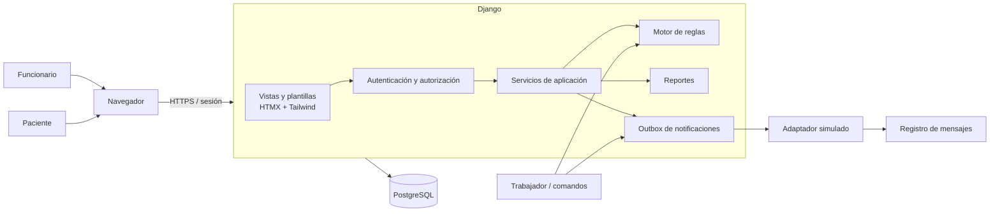

# 01 — Arquitectura tecnológica y módulos

## 1. Alternativas evaluadas

| Alternativa | Ventajas | Desventajas para este proyecto | Veredicto |
|---|---|---|---|
| **Django + PostgreSQL + plantillas + HTMX** | Autenticación, permisos, hash de contraseñas, CSRF, ORM, migraciones, formularios, admin y pruebas vienen integrados. Un solo lenguaje principal. Excelente soporte de transacciones y restricciones en PostgreSQL. | La interfaz no es una SPA; requiere aprender HTMX y Tailwind. El admin de Django debe restringirse. | **Recomendada.** |
| Next.js + PostgreSQL + Prisma | Interfaz moderna, un solo lenguaje TypeScript, buen ecosistema. | Hay que ensamblar autenticación, sesiones, CSRF, autorización y transacciones. Mayor superficie de error para estudiantes con programación básica. Prisma complica índices parciales y bloqueos explícitos. | Viable solo si el equipo ya domina TypeScript y React. |
| Laravel + MySQL/PostgreSQL | Framework completo, buena documentación, migraciones, autenticación y ORM. | Depende de que el equipo sepa PHP. MySQL es menos expresivo para índices parciales y restricciones de exclusión. | Alternativa válida si el equipo ya domina PHP/Laravel. |
| FastAPI + React | API limpia y frontend flexible. | Dos aplicaciones, dos despliegues y autenticación/sesión/CSRF manuales. Más código y más decisiones de seguridad. | No recomendada para el alcance inicial. |

## 2. Decisión recomendada

**Monolito modular** con:

| Capa | Tecnología | Motivo |
|---|---|---|
| Lenguaje | Python 3.12 | Legible, adecuado para enseñar y mantener. |
| Framework | Django 5.2 LTS | Seguridad y herramientas integradas; soporte de largo plazo. |
| Base de datos | PostgreSQL 17 | Transacciones, bloqueos de fila, índices únicos parciales, `JSONB`, disparadores y `SKIP LOCKED`. |
| Interfaz | Plantillas Django + HTMX + Tailwind CSS | Pantallas operativas rápidas sin el costo de una SPA; menor superficie de ataque. |
| Autenticación | Django auth + Argon2 + `django-axes` | Hash adecuado, sesiones y limitación de intentos. |
| Pruebas | `pytest` + `pytest-django` + `freezegun` | Pruebas unitarias, de integración y de tiempo. |
| Documentación | Markdown + Mermaid | Diagramas versionables junto al código. |
| Entorno local | Docker Compose solo para PostgreSQL; Django nativo | Menos capas que dockerizar toda la aplicación. |
| Configuración | Variables de entorno + tabla de parámetros | Secretos fuera del repositorio; reglas operativas configurables. |

### Por qué no microservicios

El volumen y el equipo no justifican microservicios. Un monolito modular permite separar responsabilidades sin agregar red, colas externas, despliegues múltiples ni consistencia distribuida. El motor y las notificaciones se comunican mediante una cola transaccional en la misma base de datos.

### Por qué PostgreSQL es obligatorio para la aceptación

SQLite no permite demostrar de forma realista:

- Bloqueos de fila con `SELECT ... FOR UPDATE`.
- Índices únicos parciales.
- `SKIP LOCKED` para trabajadores concurrentes.
- Restricciones de exclusión.
- Pruebas de dos procesos que intentan reservar la misma hora.

La aplicación puede arrancar con PostgreSQL en Docker o con una instalación nativa. No se mantendrá una segunda ruta SQLite para la demostración.

## 3. Diagrama de arquitectura



### Flujo de dependencias

```text
Vistas -> Servicios de aplicación -> Dominio y modelos
Motor -> Reglas de dominio + repositorios
Notificaciones -> DTO de evento (sin importar modelos clínicos)
Reportes -> Consultas de solo lectura
Auditoría -> Servicio transversal
```

Regla práctica: una vista no contiene reglas de asignación; un modelo no envía mensajes; el motor no depende de plantillas ni de solicitudes HTTP.

## 4. Estructura de carpetas propuesta

```text
C:\Users\Usuario\proyectos\agendamiento-medico\
├── manage.py
├── config\
│   ├── settings\
│   │   ├── base.py
│   │   ├── dev.py
│   │   └── prod.py
│   ├── urls.py
│   ├── asgi.py
│   └── wsgi.py
├── apps\
│   ├── core\              # configuración, parámetros, utilidades, salud
│   ├── accounts\          # usuarios, roles, permisos, activación, sesiones
│   ├── patients\          # pacientes, contactos, preferencias
│   ├── referrals\         # solicitudes, estados, datos clínicos, historial
│   ├── scheduling\        # establecimientos, especialidades, agendas, bloques, horas
│   ├── offers\            # ofertas, citas, cancelaciones
│   ├── engine\            # eventos, reglas, trabajador de asignación
│   ├── rescheduling\      # propuestas por ausencia médica y aprobaciones
│   ├── notifications\     # plantillas, outbox, adaptadores
│   ├── audit\             # eventos de auditoría inmutables
│   ├── reports\           # consultas agregadas y exportación
│   └── portal\            # vistas del paciente (sin modelos propios)
├── templates\
│   ├── layouts\
│   ├── components\
│   ├── staff\
│   └── portal\
├── static\
│   ├── css\
│   ├── js\
│   └── img\
├── tests\
│   ├── unit\
│   ├── integration\
│   ├── concurrency\
│   └── e2e\
├── docs\
│   ├── etapa-1\
│   ├── operacion\
│   └── seguridad\
├── scripts\
│   ├── seed_demo.py
│   └── backup.ps1
├── requirements\
│   ├── base.txt
│   └── dev.txt
├── docker-compose.yml
├── .env.example
├── .gitignore
└── README.md
```

La ruta es una propuesta; puede cambiarse antes de la Etapa 2 sin afectar el diseño.

## 5. Módulos funcionales

| Módulo | App Django | Responsabilidad principal | Etapa |
|---|---|---|---|
| A. Usuarios y permisos | `accounts` | Autenticación, roles, alcance por establecimiento, activación, recuperación. | 3 |
| B. Pacientes | `patients` | Ficha administrativa, contactos, preferencias, detección de duplicados. | 4 |
| C. Derivaciones y solicitudes | `referrals` | Ingreso, validación, estados, historial, datos clínicos restringidos. | 4 |
| D. Lista de espera | `referrals` (servicio) | Consulta derivada, filtros, orden por antigüedad, intentos. | 4 |
| E. Agendas | `scheduling` | Establecimientos, especialidades, profesionales, agendas, bloques y horas. | 5 |
| F. Motor | `engine` + `offers` + `rescheduling` | Eventos, compatibilidad, ofertas, confirmaciones, propuestas. | 6 |
| G. Portal | `portal` | Vistas y acciones del paciente con aislamiento de datos. | 7 |
| H. Notificaciones | `notifications` | Outbox, plantillas, adaptador simulado, reintentos y deduplicación. | 7 |
| I. Panel | `reports` + vistas staff | Resumen, alertas, actividad y filtros. | 8 |
| J. Reportes | `reports` | Consultas, fórmulas, CSV seguro. | 8 |
| K. Auditoría | `audit` | Eventos inmutables y correlación. | 3 |
| Configuración | `core` | Parámetros, modo demo, salud, utilidades. | 2 |

## 6. Decisiones transversales

1. **Lista de espera derivada:** no se duplica en una tabla. Se calcula desde solicitudes y ofertas para evitar inconsistencias.
2. **Oferta separada de cita:** una oferta pendiente bloquea la hora pero no crea una cita.
3. **Outbox:** la reserva y el mensaje se guardan en la misma transacción; el envío ocurre después. Un fallo de notificación no revierte la reserva.
4. **Eventos de motor:** cada liberación o cambio relevante genera un evento idempotente que un trabajador procesa.
5. **Auditoría append-only:** sin actualización ni borrado desde la aplicación.
6. **Datos clínicos separados:** tabla y permiso distintos de la ficha administrativa.
7. **Configuración:** plazos, reintentos, duraciones y umbrales en base de datos, no en constantes dispersas.
8. **Reloj inyectable:** el motor recibe la fecha/hora actual para poder probar vencimientos.
9. **Identificadores:** enteros internos para orden y claves foráneas; UUID públicos para URLs.
10. **Zona horaria:** `USE_TZ=True`, almacenamiento UTC, presentación `America/Santiago`.
