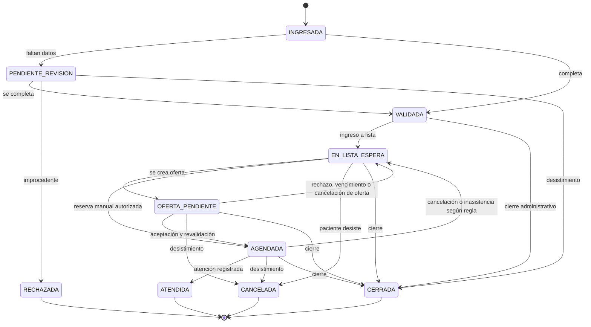
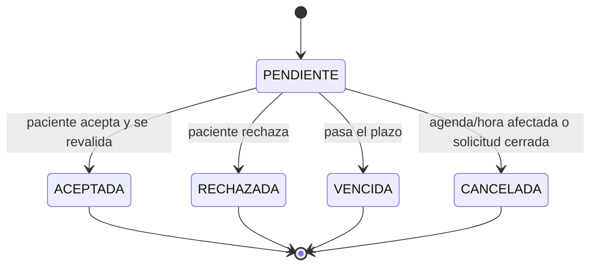
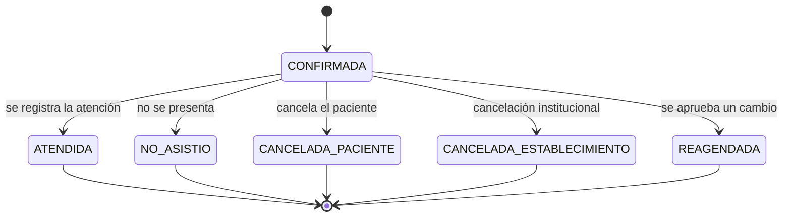
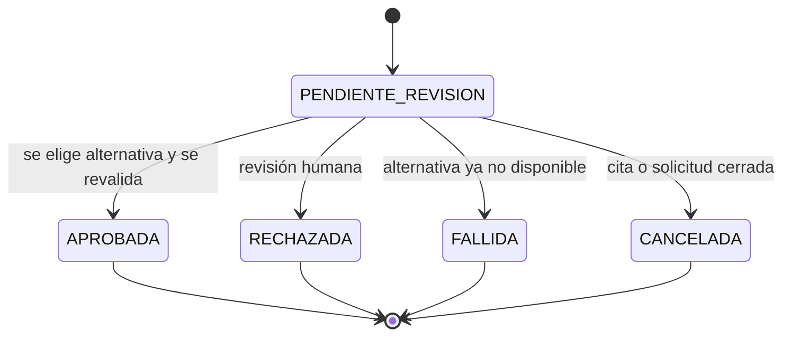

# 02 — Flujos, estados y concurrencia

## 1. Flujo de ingreso y validación de una solicitud

1. Un funcionario autorizado busca al paciente por documento o datos administrativos.
2. Si no existe, crea la ficha. El sistema normaliza el documento y advierte posibles duplicados antes de guardar.
3. Registra la solicitud: paciente, especialidad, establecimiento de origen, establecimiento de destino, origen, fecha de ingreso, referencia externa si existe y observaciones administrativas.
4. Los datos clínicos, si se requieren, se guardan en una entidad separada con permiso propio.
5. El sistema asigna un UUID público y deja la solicitud en `INGRESADA`.
6. Se ejecuta una validación administrativa de completitud:
   - Si faltan datos: `PENDIENTE_REVISION`, con una lista de faltantes y responsable.
   - Si está completa: `VALIDADA`.
7. La validación administrativa confirma especialidad, establecimiento y paciente. No emite juicio clínico.
8. Al aprobarse, se registra `fecha_lista_espera` y la solicitud pasa a `EN_LISTA_ESPERA` en la misma transacción.
9. Si se rechaza: `RECHAZADA`, con motivo obligatorio y auditoría.
10. Si se detecta otra solicitud activa del mismo paciente y especialidad, se advierte y se exige motivo para continuar. El motor excluye duplicados y deja alerta.



### Reglas de transición

- `VALIDADA` es un estado de tránsito: el ingreso a lista ocurre en la misma operación.
- `ATENDIDA`, `RECHAZADA`, `CANCELADA` y `CERRADA` son terminales.
- Una solicitud cerrada no puede recibir ofertas.
- Una solicitud con cita activa no puede recibir otra oferta.
- Una solicitud con oferta pendiente no puede recibir otra oferta.
- Toda transición pasa por un servicio de dominio, no por un formulario que escriba el estado directamente.
- Cada transición deja historial de negocio y auditoría.

## 2. Lista de espera

La lista es una **consulta derivada**, no una tabla mutable.

Incluye solicitudes en `EN_LISTA_ESPERA` y, opcionalmente, `OFERTA_PENDIENTE` con una marca visual.

Filtros:

- Especialidad.
- Establecimiento de origen o destino.
- Fecha de ingreso desde/hasta.
- Tiempo de espera mínimo/máximo.
- Estado.
- Disponibilidad declarada.
- Existencia de oferta pendiente.
- Número de intentos de citación.
- Estado de contacto.

Orden por defecto:

```sql
ORDER BY fecha_ingreso ASC, created_at ASC, id ASC
```

La posición se calcula dentro del conjunto filtrado, no globalmente. Dos solicitudes con la misma fecha se desempatan por creación e ID interno, de forma reproducible.

Indicadores visibles:

- Días desde `fecha_ingreso`.
- Días desde `fecha_lista_espera`.
- Oferta pendiente y su vencimiento.
- Último intento y su resultado.
- Alertas asociadas.

No se permite reordenar manualmente en la versión 1. Una reserva manual autorizada es una excepción operativa, no un cambio de prioridad, y exige motivo y auditoría.

## 3. Agendas y generación de horas

### Creación

1. Seleccionar establecimiento, especialidad, profesional y tipo de prestación.
2. Definir fecha de inicio, fecha de término, duración y patrón de bloques.
3. El sistema valida:
   - Profesional activo y habilitado para la especialidad.
   - Establecimiento y especialidad activos.
   - Fechas coherentes.
   - Duración mayor que cero y compatible con el tipo de prestación.
   - Bloques dentro de las fechas de la agenda.
   - Sin superposición con otra agenda publicada del mismo profesional.
   - Sin horas duplicadas.
4. La agenda se guarda en `BORRADOR`.
5. Al publicar, se generan los bloques y las horas.
6. Cada hora nace en `DISPONIBLE`.

### Generación idempotente

La generación usa una clave por agenda, bloque y hora de inicio. Repetir la generación no crea duplicados; solo completa las horas faltantes. Si un bloque cambió, no se borran horas con citas: se genera una propuesta de resolución.

### Bloqueo y suspensión

- Bloquear un bloque impide ofrecer sus horas.
- Suspender una agenda o un bloque cancela las horas futuras y afecta las citas existentes.
- Las citas afectadas pasan a un flujo de propuestas; no se reagendan silenciosamente.
- Las horas pasadas no se reutilizan.

### Invariantes

- Una hora no puede pertenecer a dos agendas.
- Un profesional no puede tener dos horas que se superpongan.
- Una hora bloqueada, cancelada o pasada no se ofrece.
- Una hora con cita confirmada no se ofrece.
- Una hora con oferta pendiente no se ofrece a otra solicitud.

## 4. Flujo de oferta y confirmación

```mermaid
sequenceDiagram
  autonumber
  participant S as Sistema/Funcionario
  participant DB as PostgreSQL
  participant M as Motor
  participant O as Outbox
  participant P as Paciente

  S->>DB: Cancelar cita o liberar hora (transacción)
  DB-->>S: Evento de motor registrado
  M->>DB: Reclamar evento (idempotente)
  M->>DB: Bloquear hora y buscar candidatos
  M->>DB: Ordenar por antigüedad y desempate
  M->>DB: Crear oferta PENDIENTE + hora OFRECIDA
  M->>O: Encolar notificación en la misma transacción
  O-->>P: Mensaje SIMULADO / aviso en portal
  P->>DB: Aceptar oferta (autenticado)
  DB->>DB: Bloquear oferta y hora; validar vigencia y estado
  DB->>DB: Crear cita CONFIRMADA; hora OCUPADA
  DB->>O: Encolar confirmación
  O-->>P: Confirmación simulada
```

### Reglas del ciclo de oferta

1. Solo se crea una oferta si la hora está `DISPONIBLE`, la agenda está publicada y la fecha es futura.
2. La oferta tiene vencimiento explícito.
3. Mientras está `PENDIENTE`, la hora queda `OFRECIDA` y no se ofrece a nadie más.
4. El paciente acepta o rechaza desde el portal autenticado.
5. Al aceptar, el sistema vuelve a validar, con bloqueo de fila:
   - La oferta sigue `PENDIENTE`.
   - No venció.
   - La hora sigue `OFRECIDA`.
   - La agenda no fue bloqueada, suspendida o cancelada.
   - El paciente no tiene otra cita superpuesta.
6. Si todo es válido, crea la cita `CONFIRMADA`, marca la hora `OCUPADA` y la oferta `ACEPTADA`.
7. Si algo falla, rechaza la aceptación con un mensaje comprensible, marca la oferta como `VENCIDA` o `CANCELADA` según corresponda y genera alerta.
8. Si el paciente rechaza, la oferta pasa a `RECHAZADA`, la hora vuelve a `DISPONIBLE` y se evalúa al siguiente candidato.
9. Si vence, la oferta pasa a `VENCIDA`, la hora se libera y se evalúa al siguiente candidato.
10. No se vuelve a ofrecer la misma hora a una solicitud que ya la rechazó o cuya oferta venció.

### Estados de la oferta



### Estados de la cita



## 5. Reagendamiento por ausencia médica o suspensión de agenda

1. Un funcionario autorizado registra la ausencia o suspensión, con motivo y rango afectado.
2. El sistema identifica las horas y citas afectadas.
3. Por cada cita, el motor busca alternativas compatibles.
4. Genera una `PropuestaReagendamiento` con una o más alternativas ordenadas.
5. La propuesta queda `PENDIENTE_REVISION`; **no se confirma automáticamente**.
6. Un usuario con permiso `reagendamiento.aprobar` revisa:
   - Aprobar una alternativa.
   - Rechazar la propuesta.
   - Solicitar una nueva búsqueda.
7. Al aprobar, el sistema revalida la hora bajo bloqueo. Si ya no está disponible, la propuesta pasa a `FALLIDA` y se genera alerta; no se fuerza la reserva.
8. Si la hora sigue disponible, la cita original pasa a `REAGENDADA`, se crea la nueva cita `CONFIRMADA` y se actualiza la hora.
9. Se notifica al paciente y se audita todo el proceso con un identificador de correlación.
10. Si se rechaza, la cita original permanece cancelada por la suspensión y se genera una tarea para gestión humana.

### Estados de la propuesta



## 6. Rechazo, vencimiento, cancelación e inasistencia

| Evento | Efecto inmediato | Efecto sobre la solicitud | Efecto sobre la hora |
|---|---|---|---|
| Paciente rechaza oferta | Oferta `RECHAZADA` | Vuelve a `EN_LISTA_ESPERA` | Vuelve a `DISPONIBLE`; se evalúa siguiente candidato. |
| Oferta vence | Oferta `VENCIDA` | Vuelve a `EN_LISTA_ESPERA` | Vuelve a `DISPONIBLE`; se evalúa siguiente candidato. |
| Paciente cancela cita | Cita `CANCELADA_PACIENTE` | Vuelve a lista, según regla configurable | Se libera si la agenda lo permite. |
| Establecimiento cancela cita | Cita `CANCELADA_ESTABLECIMIENTO` | Vuelve a lista o a propuesta, según causa | Se cancela o libera. |
| Inasistencia | Cita `NO_ASISTIO` | Vuelve a lista con alerta; sin sanción automática en demo | La hora queda ocupada históricamente. |
| Agenda suspendida | Citas afectadas | Propuesta pendiente de revisión | Horas canceladas. |

Ninguna de estas consecuencias se considera una regla institucional definitiva. Son valores de demostración configurables.

## 7. Prevención de asignaciones dobles

La garantía se construye en capas; ninguna capa por sí sola es suficiente.

| Invariante | Mecanismo principal | Refuerzo |
|---|---|---|
| Una hora no tiene dos ofertas pendientes | Índice único parcial en `oferta(hora_id) WHERE estado='PENDIENTE'` | Bloqueo de fila de la hora. |
| Una solicitud no tiene dos ofertas pendientes | Índice único parcial en `oferta(solicitud_id) WHERE estado='PENDIENTE'` | Bloqueo de la solicitud candidata. |
| Una hora no tiene dos citas activas | Índice único parcial en `cita(hora_id) WHERE estado IN ('CONFIRMADA','ATENDIDA')` | Revalidación al aceptar. |
| Una solicitud no tiene dos citas activas | Índice único parcial en `cita(solicitud_id) WHERE estado IN ('CONFIRMADA','ATENDIDA')` | Servicio de reserva. |
| Dos trabajadores no procesan el mismo evento | `SELECT ... FOR UPDATE SKIP LOCKED` + clave idempotente única | Estado del evento y reintentos. |
| Un aceptar repetido no crea dos citas | Estado de la oferta + bloqueo + índice único | Respuesta idempotente. |
| Un reintento no repite una notificación | `dedupe_key` única en outbox | Estado del mensaje. |
| Un reintento no repite una oferta | Clave única por evento, hora, solicitud e intento | Verificación de estado. |
| Paciente con dos solicitudes no recibe ofertas simultáneas | Bloqueo de la fila del paciente y verificación de ofertas/citas activas | Prueba concurrente con dos solicitudes. |
| Propuesta aprobada no duplica cita | Revalidación y bloqueo de la hora | Índice único parcial. |

### Bloqueo y orden de adquisición

Para aceptar una oferta:

```text
BEGIN
  SELECT ... FROM oferta WHERE id = ? FOR UPDATE
  SELECT ... FROM hora_medica WHERE id = ? FOR UPDATE
  verificar estados y vencimiento
  verificar que el paciente no tenga otra cita superpuesta
  INSERT cita ...
  UPDATE oferta ...
  UPDATE hora_medica ...
  INSERT outbox ...
COMMIT
```

Para crear una oferta:

```text
BEGIN
  SELECT ... FROM hora_medica WHERE id = ? FOR UPDATE
  verificar disponibilidad
  SELECT ... FROM solicitud WHERE id = ? FOR UPDATE
  verificar estado y ausencia de ofertas/citas activas
  INSERT oferta ...
  UPDATE hora_medica ...
  INSERT outbox ...
COMMIT
```

Siempre se bloquea primero la hora y luego la solicitud o el paciente. Si se requiere bloquear varias horas, se ordenan por ID para reducir interbloqueos.

### Compare-and-set como refuerzo

Además del bloqueo, las actualizaciones críticas usan condiciones de estado:

```sql
UPDATE hora_medica
SET estado = 'OFRECIDA', version = version + 1
WHERE id = :hora_id AND estado = 'DISPONIBLE' AND version = :version;
```

Si la fila afectada es 0, la operación se considera conflicto y se reintenta o se informa, sin asumir éxito.

## 8. Idempotencia y reintentos

### Eventos del motor

Cada evento tiene una clave idempotente, por ejemplo:

```text
cancelacion:{cita_uuid}
liberacion:{hora_uuid}:{timestamp_de_version}
suspension:{agenda_uuid}:{bloque_uuid}
vencimiento:{oferta_uuid}
```

El trabajador:

1. Reclama un evento `PENDIENTE` con `FOR UPDATE SKIP LOCKED`.
2. Lo marca `PROCESANDO`.
3. Ejecuta la transacción.
4. Lo marca `COMPLETADO` o `FALLIDO`.
5. Si falla, incrementa intentos y programa el próximo con backoff.
6. Si el proceso muere, la transacción se revierte y el evento sigue disponible.

### Ofertas

La creación usa una clave única:

```text
oferta:{evento_id}:{hora_id}:{solicitud_id}:{attempt_no}
```

Repetir la misma operación no crea otra oferta.

### Notificaciones

El outbox usa una clave como:

```text
oferta:{oferta_uuid}:creada:{canal}
cita:{cita_uuid}:confirmada:{canal}
recordatorio:{cita_uuid}:24h:{canal}
```

La clave es única. Un reintento actualiza el mismo registro; no crea otro mensaje.

### Confirmación de aceptación

Si el paciente envía dos veces “aceptar”:

- La primera transacción confirma la oferta y crea la cita.
- La segunda encuentra la oferta `ACEPTADA` y devuelve la misma cita, sin crear otra.
- Si la oferta ya venció, responde con un mensaje claro y ofrece volver a la lista.

## 9. Notificaciones desacopladas

1. El servicio de negocio escribe el mensaje en `mensaje_notificacion` dentro de la misma transacción que la reserva o la oferta.
2. Un trabajador independiente toma mensajes `PENDIENTES`.
3. El adaptador simulado registra el contenido y el estado `SIMULADO`; no llama a ningún proveedor.
4. Si el adaptador falla, el mensaje queda `FALLIDO`, con intentos y próximo reintento.
5. Tras el máximo de intentos, se genera una alerta operativa.
6. La interfaz muestra siempre “SIMULADO” o “NO ENVIADO REALMENTE”.
7. Los mensajes externos no contienen diagnóstico, motivo clínico ni notas.
8. Los enlaces llevan al portal autenticado; si se usa un token, se guarda su hash, es de un solo uso y tiene caducidad.

## 10. Portal del paciente

- Cuenta creada por un funcionario y activada con código de un solo uso.
- Sin autorregistro por RUT, para reducir suplantación y enumeración.
- Cada consulta filtra por `paciente.usuario = request.user`.
- Cada acción vuelve a verificar propiedad y estado en el servidor.
- Los UUID no se consideran un mecanismo de autorización.
- El paciente no ve datos de otros pacientes, ni notas clínicas no autorizadas, ni información interna de funcionarios.
- Puede actualizar contactos y preferencias; los cambios quedan auditados.
- Puede aceptar o rechazar solo ofertas propias y vigentes.
