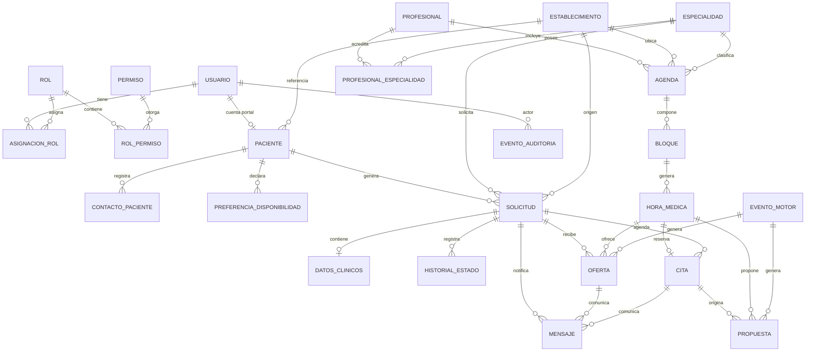

# 03 — Modelo de datos inicial

## 1. Principios

1. **Normalización:** no se duplican pacientes, profesionales, especialidades ni agendas en varias tablas.
2. **Identificadores:** clave interna `BIGINT` para relaciones y orden; `UUID` público para URLs y referencias externas.
3. **Lista de espera derivada:** no existe una tabla `lista_espera`; se consulta desde solicitudes y ofertas.
4. **Historial separado de auditoría:** `historial_estado` cuenta la historia del negocio; `evento_auditoria` registra acciones y accesos relevantes.
5. **Datos clínicos separados:** `datos_clinicos_solicitud` tiene permiso propio y no se incluye en listados administrativos.
6. **Borrado lógico:** pacientes, solicitudes y agendas con historia no se eliminan físicamente. Se desactivan o cierran.
7. **Restricciones en la base:** las invariantes críticas no dependen solo de la interfaz.
8. **Fechas:** `TIMESTAMPTZ` en UTC; presentación en `America/Santiago`.

## 2. Diagrama entidad-relación



## 3. Entidades

### 3.1 Identidad y acceso

| Entidad | Campos principales | Restricciones e índices |
|---|---|---|
| `usuario` | `id`, `uuid`, `email`, `password_hash`, `nombres`, `apellidos`, `tipo` (`FUNCIONARIO`/`PACIENTE`), `activo`, `debe_cambiar_password`, `ultimo_acceso`, timestamps | Email único sin distinguir mayúsculas. Nunca guardar contraseña en claro. |
| `rol` | `id`, `codigo`, `nombre`, `descripcion` | Código único. |
| `permiso` | `id`, `codigo`, `descripcion` | Código único. |
| `rol_permiso` | `rol_id`, `permiso_id` | PK compuesta. |
| `asignacion_rol` | `usuario_id`, `rol_id`, `establecimiento_id` (nullable), `vigente_desde`, `vigente_hasta` | Único por usuario, rol y establecimiento. `NULL` = alcance global. |
| `intento_acceso` | `email`, `ip_hash`, `exitoso`, `fecha` | Índice por email y fecha; retención limitada. |
| `token_activacion` | `usuario_id`, `hash_token`, `expira_en`, `usado_en` | Hash único; un solo uso. |
| `evento_sesion` | `usuario_id`, `tipo`, `fecha`, `correlation_id`, `ip_hash` | Login, logout y fallos; sin contraseñas. |

### 3.2 Red asistencial

| Entidad | Campos principales | Restricciones |
|---|---|---|
| `establecimiento` | `id`, `codigo`, `nombre`, `tipo`, `comuna`, `region`, `activo` | Código único. |
| `especialidad` | `id`, `codigo`, `nombre`, `activa`, `requiere_derivacion` | Código único. |
| `profesional` | `id`, `uuid`, `usuario_id` (nullable), `nombres`, `apellidos`, `documento`, `activo` | Documento único si existe. Un profesional puede no tener cuenta de sistema. |
| `profesional_especialidad` | `profesional_id`, `especialidad_id` | PK compuesta. |
| `tipo_prestacion` | `id`, `codigo`, `nombre`, `duracion_default_min`, `activo` | Código único; duración configurable. |

### 3.3 Pacientes

| Entidad | Campos principales | Restricciones |
|---|---|---|
| `paciente` | `id`, `uuid`, `tipo_documento`, `numero_documento`, `numero_documento_normalizado`, `nombres`, `apellidos`, `nombre_normalizado`, `fecha_nacimiento`, `sexo_registral` (opcional), `establecimiento_referencia_id`, `usuario_id` (nullable, unique), `estado_contacto`, `activo`, timestamps | Documento único por tipo cuando existe. `usuario_id` único: una cuenta portal por paciente. |
| `contacto_paciente` | `id`, `paciente_id`, `tipo` (`TELEFONO`/`EMAIL`/`WHATSAPP`), `valor`, `valor_normalizado`, `preferido`, `verificado_en`, `consentimiento`, `vigente` | Único por paciente, tipo y valor vigente. Un solo preferido por paciente mediante índice parcial. |
| `preferencia_disponibilidad` | `id`, `paciente_id`, `dia_semana`, `hora_desde`, `hora_hasta`, `es_restriccion`, `vigente_desde`, `vigente_hasta` | `hora_desde < hora_hasta`; sin superposición por paciente y día. |

Detección de duplicados:

- Validación fuerte por documento normalizado.
- Advertencia por nombre, apellido y fecha de nacimiento.
- La advertencia no bloquea automáticamente; exige revisión y motivo.
- No se usa el nombre como clave única.

### 3.4 Solicitudes y datos clínicos

| Entidad | Campos principales | Restricciones |
|---|---|---|
| `solicitud` | `id`, `uuid`, `paciente_id`, `especialidad_id`, `establecimiento_origen_id`, `establecimiento_destino_id`, `origen`, `estado`, `fecha_ingreso`, `fecha_validacion`, `fecha_lista_espera`, `referencia_externa`, `observaciones_administrativas`, `motivo_cierre`, `creada_por_id`, `version`, timestamps | `uuid` único. `referencia_externa` único cuando no es nulo. Índices por estado, especialidad y fecha de ingreso. |
| `datos_clinicos_solicitud` | `id`, `solicitud_id` (unique), `motivo_derivacion`, `diagnostico_codigo`, `diagnostico_texto`, `notas`, `creado_por_id`, `actualizado_por_id`, timestamps | OneToOne con solicitud. Acceso restringido. No se incluye en listados administrativos ni notificaciones. |
| `historial_estado_solicitud` | `id`, `solicitud_id`, `estado_anterior`, `estado_nuevo`, `actor_usuario_id` (nullable), `actor_tipo`, `motivo`, `correlation_id`, `fecha` | Append-only. Índice por solicitud y fecha. |
| `alerta_operativa` | `id`, `tipo`, `severidad`, `entidad_tipo`, `entidad_id`, `mensaje`, `estado`, `asignada_a_id`, `correlation_id`, timestamps | Índice único parcial para evitar alertas abiertas duplicadas por entidad y tipo. |

Estados de solicitud: `INGRESADA`, `PENDIENTE_REVISION`, `VALIDADA`, `EN_LISTA_ESPERA`, `OFERTA_PENDIENTE`, `AGENDADA`, `ATENDIDA`, `RECHAZADA`, `CANCELADA`, `CERRADA`.

### 3.5 Agendas y horas

| Entidad | Campos principales | Restricciones |
|---|---|---|
| `agenda` | `id`, `uuid`, `profesional_id`, `establecimiento_id`, `especialidad_id`, `tipo_prestacion_id` (nullable), `fecha_inicio`, `fecha_fin`, `duracion_min`, `estado`, `creada_por_id`, `version`, timestamps | `fecha_inicio <= fecha_fin`. Estado: `BORRADOR`, `PUBLICADA`, `SUSPENDIDA`, `CERRADA`. |
| `bloque_agenda` | `id`, `agenda_id`, `fecha`, `hora_inicio`, `hora_fin`, `estado`, `motivo`, timestamps | `hora_inicio < hora_fin`; `fecha` dentro del rango de la agenda; único por agenda, fecha y hora de inicio. |
| `hora_medica` | `id`, `uuid`, `bloque_id`, `inicio`, `fin`, `estado`, `version`, `motivo_cancelacion`, timestamps | `inicio < fin`; único por bloque e inicio. Índice por inicio y estado. Estado: `DISPONIBLE`, `OFRECIDA`, `OCUPADA`, `BLOQUEADA`, `CANCELADA`. |

Reglas:

- Un bloque puede estar `DISPONIBLE`, `BLOQUEADO` o `SUSPENDIDO`.
- Una hora hereda la disponibilidad del bloque.
- No se generan horas fuera del bloque.
- No se generan horas solapadas dentro de la agenda.
- Publicar una agenda con superposición con otra agenda publicada del mismo profesional se rechaza.
- Suspender una agenda no borra horas: las marca `CANCELADA` y conserva la historia.

### 3.6 Ofertas, citas y cancelaciones

| Entidad | Campos principales | Restricciones |
|---|---|---|
| `oferta_hora` | `id`, `uuid`, `solicitud_id`, `hora_id`, `estado`, `canal`, `expira_en`, `respondida_en`, `attempt_no`, `idempotency_key`, `creada_por_tipo`, `creada_por_id` (nullable), `motivo_cierre`, `correlation_id`, `version`, timestamps | `idempotency_key` único. `expira_en > created_at`. Índices únicos parciales: una `PENDIENTE` por hora y una `PENDIENTE` por solicitud. |
| `cita` | `id`, `uuid`, `solicitud_id`, `hora_id`, `oferta_id` (nullable, unique), `estado`, `confirmada_en`, `atendida_en`, `cancelada_en`, `no_asistio_en`, `registrada_por_id`, `correlation_id`, `version`, timestamps | Una cita activa por hora y una por solicitud mediante índices únicos parciales. `hora_id` único entre citas activas. |
| `cancelacion_cita` | `id`, `cita_id` (unique), `motivo_codigo`, `motivo_texto`, `actor_tipo`, `actor_usuario_id` (nullable), `canal`, `fecha`, `correlation_id` | Una cancelación por cita. No se borra si la cita se reabre; se genera otra cita. |

Estados de oferta: `PENDIENTE`, `ACEPTADA`, `RECHAZADA`, `VENCIDA`, `CANCELADA`.

Estados de cita: `CONFIRMADA`, `ATENDIDA`, `NO_ASISTIO`, `CANCELADA_PACIENTE`, `CANCELADA_ESTABLECIMIENTO`, `REAGENDADA`.

### 3.7 Reagendamiento

| Entidad | Campos principales | Restricciones |
|---|---|---|
| `propuesta_reagendamiento` | `id`, `uuid`, `cita_original_id`, `solicitud_id`, `estado`, `motivo`, `creada_por_tipo`, `revisada_por_id` (nullable), `revisada_en`, `decision_motivo`, `correlation_id`, `version`, timestamps | Una propuesta pendiente por cita mediante índice único parcial. |
| `alternativa_propuesta` | `id`, `propuesta_id`, `hora_id`, `orden`, `estado_validacion`, `motivo_fallo` | Único por propuesta, hora y orden. No reserva la hora hasta la aprobación. |

Estados de propuesta: `PENDIENTE_REVISION`, `APROBADA`, `RECHAZADA`, `FALLIDA`, `CANCELADA`.

Decisión de la versión 1: la propuesta **no bloquea** la hora propuesta. Al aprobar se revalida. Si ya no está disponible, la propuesta falla y se alerta. Esto evita inmovilizar cupos durante una revisión humana de duración desconocida. Es una decisión reversible; la alternativa es una reserva temporal con vencimiento.

### 3.8 Notificaciones

| Entidad | Campos principales | Restricciones |
|---|---|---|
| `plantilla_notificacion` | `id`, `codigo`, `canal`, `asunto`, `cuerpo`, `version`, `activa`, timestamps | Único por código y versión. |
| `mensaje_notificacion` | `id`, `uuid`, `destinatario_tipo`, `paciente_id` (nullable), `usuario_id` (nullable), `canal`, `plantilla_id`, `oferta_id` (nullable), `cita_id` (nullable), `solicitud_id` (nullable), `payload_json`, `estado`, `dedupe_key`, `intentos`, `max_intentos`, `proximo_intento`, `enviado_simulado_en`, `leido_en`, `error_codigo`, `error_detalle`, `correlation_id`, timestamps | `dedupe_key` única. `payload_json` solo con datos mínimos. Estado: `PENDIENTE`, `SIMULADO`, `FALLIDO`, `DESCARTADO`, `LEIDO`. |

No se guardan diagnósticos, notas clínicas ni tokens en `payload_json`.

### 3.9 Motor, configuración y auditoría

| Entidad | Campos principales | Restricciones |
|---|---|---|
| `evento_motor` | `id`, `idempotency_key`, `tipo_evento`, `entidad_tipo`, `entidad_id`, `payload_json`, `estado`, `intentos`, `max_intentos`, `proximo_intento`, `correlation_id`, `error_codigo`, `error_detalle`, `created_at`, `processed_at` | `idempotency_key` única. Estado: `PENDIENTE`, `PROCESANDO`, `COMPLETADO`, `FALLIDO`, `DESCARTADO`. |
| `parametro_sistema` | `id`, `clave`, `valor_json`, `tipo`, `grupo`, `descripcion`, `editable`, `vigente_desde`, `actualizado_por_id`, timestamps | `clave` única. Cambios auditados. |
| `evento_auditoria` | `id`, `fecha`, `actor_tipo`, `actor_usuario_id` (nullable), `accion`, `entidad_tipo`, `entidad_id`, `estado_anterior_json`, `estado_nuevo_json`, `motivo`, `resultado`, `correlation_id`, `ip_hash`, `user_agent_resumido` | Append-only. Índices por entidad, fecha y correlación. Sin contraseñas, tokens ni datos clínicos completos. |
| `metadato_semilla` | `id`, `nombre`, `version`, `fecha`, `descripcion`, `es_demo` | Permite identificar el conjunto de datos ficticios cargado. |

## 4. Restricciones críticas en PostgreSQL

### Índices únicos parciales

```sql
-- Una sola oferta pendiente por hora
CREATE UNIQUE INDEX ux_oferta_pendiente_hora
ON oferta_hora (hora_id)
WHERE estado = 'PENDIENTE';

-- Una sola oferta pendiente por solicitud
CREATE UNIQUE INDEX ux_oferta_pendiente_solicitud
ON oferta_hora (solicitud_id)
WHERE estado = 'PENDIENTE';

-- Una sola cita activa por hora
CREATE UNIQUE INDEX ux_cita_activa_hora
ON cita (hora_id)
WHERE estado IN ('CONFIRMADA', 'ATENDIDA');

-- Una sola cita activa por solicitud
CREATE UNIQUE INDEX ux_cita_activa_solicitud
ON cita (solicitud_id)
WHERE estado IN ('CONFIRMADA', 'ATENDIDA');

-- Una sola propuesta pendiente por cita
CREATE UNIQUE INDEX ux_propuesta_pendiente_cita
ON propuesta_reagendamiento (cita_original_id)
WHERE estado = 'PENDIENTE_REVISION';

-- Un solo contacto preferido por paciente
CREATE UNIQUE INDEX ux_contacto_preferido
ON contacto_paciente (paciente_id)
WHERE preferido = TRUE AND vigente = TRUE;
```

### Restricciones de verificación

```sql
ALTER TABLE hora_medica
ADD CONSTRAINT ck_hora_rango CHECK (inicio < fin);

ALTER TABLE bloque_agenda
ADD CONSTRAINT ck_bloque_rango CHECK (hora_inicio < hora_fin);

ALTER TABLE oferta_hora
ADD CONSTRAINT ck_oferta_vigencia CHECK (expira_en > created_at);

ALTER TABLE preferencia_disponibilidad
ADD CONSTRAINT ck_disponibilidad_rango CHECK (hora_desde < hora_hasta);
```

### Claves foráneas

- `PROTECT` para pacientes, solicitudes, citas y auditoría: no se elimina un registro con historia.
- `CASCADE` solo en tablas dependientes sin valor histórico, como `rol_permiso`.
- `SET NULL` para actores de sistema o usuarios desactivados, conservando el evento.

### Auditoría inmutable

Un disparador de PostgreSQL impide `UPDATE` y `DELETE` sobre `evento_auditoria`. La aplicación usa un usuario de base de datos sin permisos de modificación sobre esa tabla. La corrección de un error de auditoría se hace con un evento compensatorio, no editando el anterior.

## 5. Índices recomendados

| Tabla | Índice | Uso |
|---|---|---|
| `solicitud` | `(estado, especialidad_id, fecha_ingreso)` | Lista de espera y reportes. |
| `solicitud` | `(paciente_id, estado)` | Historial y detección de duplicados. |
| `hora_medica` | `(inicio, estado)` | Búsqueda de disponibilidad. |
| `hora_medica` | `(bloque_id, inicio)` único | Generación idempotente. |
| `oferta_hora` | `(estado, expira_en)` | Vencimientos. |
| `evento_motor` | `(estado, proximo_intento)` | Cola de trabajador. |
| `mensaje_notificacion` | `(estado, proximo_intento)` | Reintentos. |
| `evento_auditoria` | `(entidad_tipo, entidad_id, fecha)` | Trazabilidad. |
| `evento_auditoria` | `(correlation_id)` | Seguimiento de un proceso. |
| `paciente` | `(nombre_normalizado)` con `pg_trgm` | Búsqueda y similitud. |

Extensiones opcionales: `unaccent` para búsqueda sin tildes y `pg_trgm` para similitud. Se habilitan con migraciones, no manualmente en producción.

## 6. Reglas de integridad que no se pueden delegar solo a la base

- Un paciente no debe tener dos citas superpuestas: se valida en el servicio con bloqueo de la fila del paciente; PostgreSQL no puede expresarlo con un índice simple.
- Una oferta no debe existir para una solicitud cerrada: se valida en el servicio y se prueba; además, la creación de oferta bloquea la solicitud.
- Una hora no debe ofrecerse si su agenda está suspendida: se valida en el servicio y se refuerza con el estado de la hora.
- Una propuesta no debe aprobarse sin permiso: se valida en la capa de autorización y en el servicio.
- Una transición de estado inválida debe rechazarse: se implementa una máquina de estados explícita con pruebas.

## 7. Historial y auditoría: diferencia

| Necesidad | Entidad | Ejemplo |
|---|---|---|
| Entender la vida de una solicitud | `historial_estado_solicitud` | “Pasó de EN_LISTA_ESPERA a AGENDADA el 12/10 por aceptación de oferta”. |
| Investigar una acción o acceso | `evento_auditoria` | “El usuario 42 aprobó la propuesta 18; antes PENDIENTE, después APROBADA; correlación X”. |
| Reprocesar un evento automático | `evento_motor` | “Cancelación de cita 77 pendiente, intento 1”. |
| Reconstruir una comunicación | `mensaje_notificacion` | “Oferta 123, canal portal, estado SIMULADO”. |
